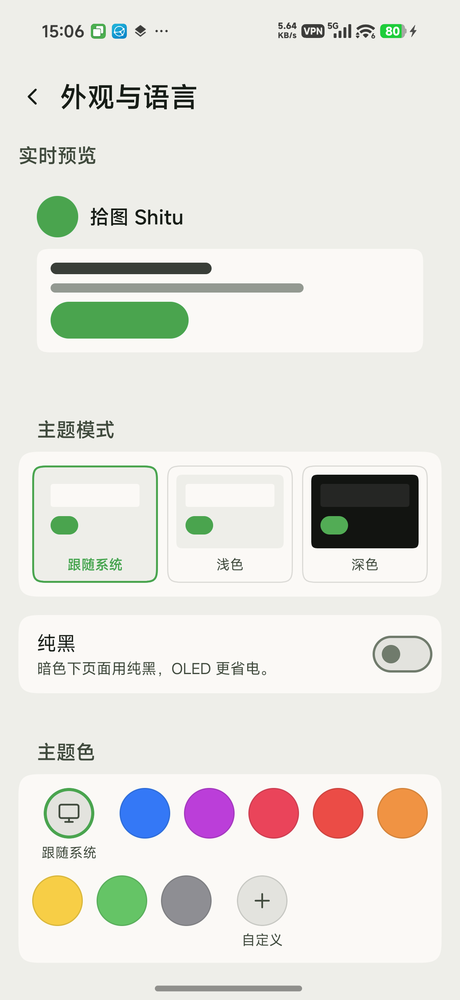

Language / 语言：<a href="README.md">汉语</a> · <b>English</b>

# Shitu

**Picks up pictures hidden on your phone and moves them into a folder you choose — automatically.**

Download: [latest APK](https://github.com/Landslide3154/shitu-android/releases) · Package: `com.landslide.shitu`

---

## What it does

Many apps keep their pictures in `Android/data/<package>/…` — a place normal apps can't open and the gallery never shows.
Shitu looks at a folder you pick and moves new pictures into another folder you pick, so they show up in your gallery.

## Two ways to run it

| | Where it can read/write | What you need |
| --- | --- | --- |
| **Standard mode** | Gallery, Downloads, Pictures, DCIM — normal folders | Turn on "All files access" in Settings → Storage access |
| **Shizuku mode** | Also `Android/data`, where apps hide their pictures | Install [Shizuku](https://shizuku.rikka.app/) and grant access |

Shizuku is used when available; otherwise Shitu falls back to standard mode. No reinstall, no rule changes.
Without Shizuku, pictures inside `Android/data` can't be reached (the system doesn't allow it).

## Screenshots

<table>
  <tr>
    <td></td>
    <td></td>
    <td></td>
  </tr>
  <tr>
    <td align="center">Move is green, copy is blue</td>
    <td align="center">Six clear cards</td>
    <td align="center">Thumbnails and filters</td>
  </tr>
  <tr>
    <td></td>
    <td></td>
    <td></td>
  </tr>
  <tr>
    <td align="center">Grouped settings, one level deep</td>
    <td align="center">Type a path or browse</td>
    <td align="center">Colors, text size, dock style</td>
  </tr>
</table>

## Install

1. Open [Releases](https://github.com/Landslide3154/shitu-android/releases) and download the latest `shitu-<version>.apk`
2. Tap to install (allow "install unknown apps" the first time)
3. Open Shitu

## First run

1. Look at the status card: "**Standard mode**" or "**Shizuku ready**" means you're good to go. Otherwise tap **Self-check** and fix the red item.
2. Tap **`+`** → **Blank rule**
3. Name it, choose a **source folder** and a **target folder** (both start at `/sdcard`)
4. Keep mode on **Copy**, tap **Save and start moving** — it shows how many files would move before saving
5. Wait a few minutes and check your gallery; once happy, switch the rule to **Move**

## Features

**Interface**

- A floating dock on phones (Rules / Logs / Settings); switch to a docked bar under Appearance → Navigation style. Tablets and landscape use a left sidebar.
- Theme center: system / light / dark, pure black, 8 accent colors + a custom picker, Vivid / Tinted / Soft / Mono, text size 80–140%, and tab animation.
- Destructive actions share one red confirm dialog; common switches and confirms give light haptic feedback.

**Rules**

- Overview card: channel status and a **Self-check** button on the left; total moved / this week / enabled rules on the right. The weekly summary is in the overflow menu.
- One card per rule: switch to enable, tap to edit, long-press for duplicate / undo / resume / delete.
- Search by rule name, source or target; multi-select to enable, pause or delete in bulk.
- Sort mode: drag the handle, or use move up / down; the order is remembered.
- Compact mode is one line per rule; detailed mode splits source and target onto two aligned lines.
- Move is green, copy is blue.

**Edit rule**

- Six cards: name, source, target, mode, frequency, file names.
- Back and **Save and start moving** at the top; a **dry-run preview** shows how many files would move and how big they are.
- "Only last N days", "at least N KB", one subfolder per app, and **rename by content (15-char code)** so the same photo is never stored twice.
- Frequency is only a fallback: normally a changed source folder is picked up within seconds.

**Logs**

- Thumbnails for destination pictures; green "moved", blue "copied"; tap a row for the full paths and failure reason.
- The search box suggests paths used by your rules (✕ clears it).
- Filter by result or rule, pause refresh, and export CSV.
- Duplicate skips are counted, not logged.

**Settings**

- **Run conditions** with manual priority (top to bottom, first match wins): charging / stop after X min locked / low battery / screen on / locked. All off = move any time.
- **Detection timing**: faster checks while the screen is on; move as soon as writing finishes.
- **Run parameters**: scan budget, per-run / per-minute caps, log retention — defaults suit most phones.
- **Storage access**, **copy records** (clear selected), and **backup** (restore rules, settings, or both).
- **Appearance**: theme center, dock style, tab animation, text size; language follows the system, 汉语 or English.
- **Notifications**, **self-check** (permissions, Shizuku, database; result can be copied), and **update checks** (at most once a day, with a notification).
- Long-press the launcher icon for **Move now / Logs / Settings** shortcuts.

## Scan & move timing

At a glance:

| Phone state | Typically moved in |
| --- | --- |
| **Screen on & unlocked** (foreground or background) | **10–20s** |
| **First few minutes after locking** (not yet deep asleep) | **30–60s** |
| **Locked for a while, phone in deep sleep** | waits for the next alarm — **several minutes, up to ~10 min** |
| **File in a rarely used subfolder** | waits for a full rule scan — **5 min default** (1–30 min) |

> In short: fastest with the screen on; still quick in the first minutes after locking; once the phone deep-sleeps, it waits for the 10-minute alarm.

### Why locking for a while is slower

- For the first few minutes after locking, the app checks source folders every 30s, so new files usually move in 30–60s.
- After about 4 minutes (varies by phone), Android puts the phone into **deep sleep (Doze)** and pauses the 30s timer; only the app's **10-minute alarm** can wake it.
- The alarm runs on a fixed schedule, so the wait depends on how far away the next alarm is: **several minutes to 10 minutes is normal**, not a stuck app.
- Tip: watch the “last run” time in the ongoing notification; if it stops updating every minute, the phone is probably deep asleep.

### Why charging / USB debugging looks faster

- **Scan frequency does not depend on charging**: charging only affects the “move while charging” run condition; it does not speed up scans.
- But **a phone that is charging or connected to a computer tends to enter deep sleep later**, so it looks faster. The 10–20s / 30–60s measured over USB only apply while the timer is still running.
- To keep 30–60s while locked on battery, the app would have to stay awake after locking, which uses more battery; it is off by default.

### Other things that affect timing

- While **run conditions are not met**, nothing is scanned (the notification says why). It resumes on the next tick after conditions allow.
- A file must be **finished writing** before it moves: by default two observations ≥3s apart with the same size/mtime; downloads still in progress wait (up to about 30s).
- A **full rule scan** runs every 5 minutes by default; deep subfolders the fast check cannot see wait up to one rule interval.
- Duplicate content in the target, paused/failed rules, extension/size/age filters, or `Android/data` without Shizuku can skip or fail the move.

## FAQ

**Nothing is being moved.** Tap **Self-check** on the status card, then check the failure reason in Logs.

**Will it delete my pictures?** No. Failed moves leave the source untouched, a bad move is rolled back, and existing files are never overwritten.

**How do I switch the interface language?** Settings → Appearance → language: System / 汉语 / English.

**Only one feature goes online** — "Check for updates" (GitHub Releases; also checked automatically at most once a day). Everything else is offline.

## More

- Detailed manual (Chinese): [使用手册](docs/使用手册.md)
- Changelog: [CHANGELOG](docs/CHANGELOG.md)
- 汉语说明: [README.md](README.md)

---

