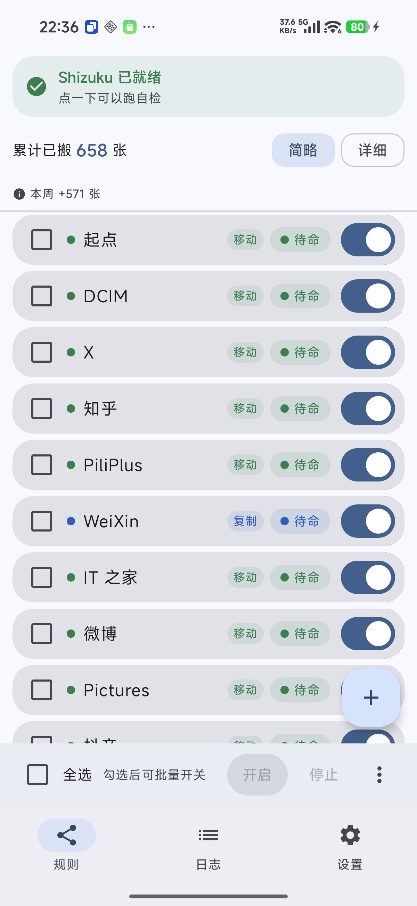
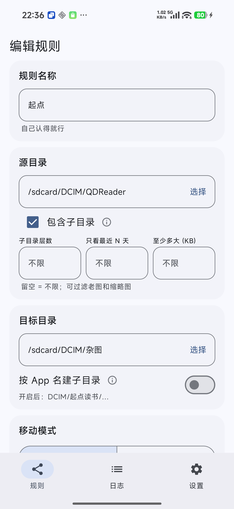
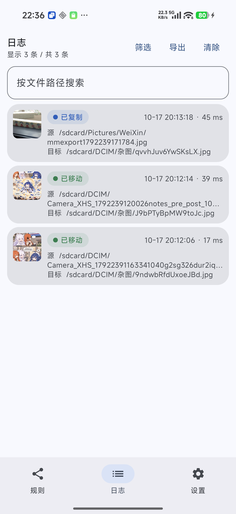
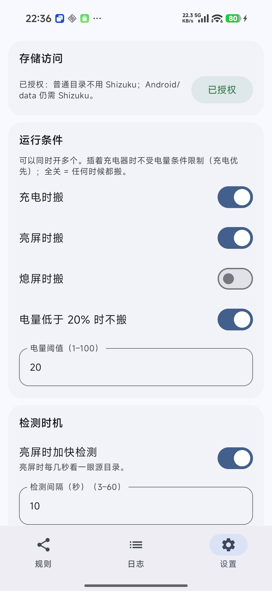
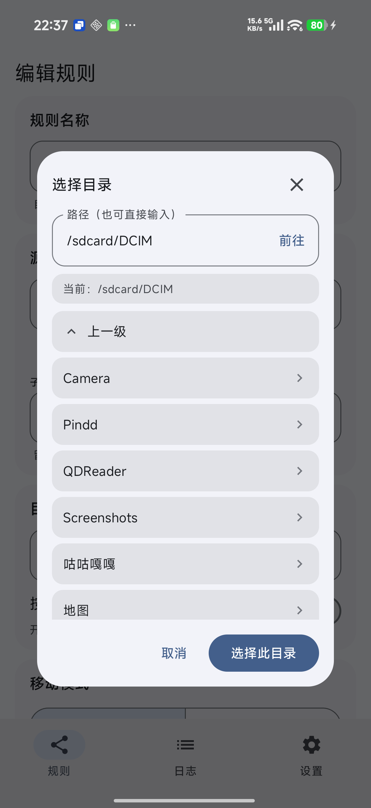

# 拾图 Shitu

**把手机里藏起来的图片，自动搬进你自己的文件夹。**

下载：[最新版 APK](https://github.com/Landslide3154/shitu-android/releases)　·　包名：`com.landslide.shitu`

---

## 它解决什么问题

很多 App 会把图片藏在 `Android/data/<包名>/…` 里——普通应用点不进去，相册里也看不到。
拾图做的事很简单：**每隔几分钟看一眼你指定的文件夹，把新的图片搬到另一个你指定的文件夹**，搬完相册里就有了。

## 两种用法，选一种就能跑

| | 能搬哪里 | 需要准备什么 |
| --- | --- | --- |
| **普通模式** | 相册、下载、Pictures、DCIM 这些普通文件夹 | 在「设置 → 存储访问」里打开「所有文件访问」 |
| **Shizuku 模式** | 再加上 `Android/data` 里 App 私藏的图片 | 装好 [Shizuku](https://shizuku.rikka.app/) 并授权 |

不用二选一：**有 Shizuku 就自动用 Shizuku，没有就用普通模式**，随时切换，不用重装。
唯一的区别是——不装 Shizuku 时，`Android/data` 里面的图搬不了（系统不让我们进）。

## 界面

<table>
  <tr>
    <td></td>
    <td></td>
    <td></td>
  </tr>
  <tr>
    <td align="center">规则：移动绿、复制蓝</td>
    <td align="center">编辑规则：六块分清楚</td>
    <td align="center">日志：缩略图 + 筛选</td>
  </tr>
  <tr>
    <td></td>
    <td></td>
    <td></td>
  </tr>
  <tr>
    <td align="center">设置：运行条件、备份</td>
    <td align="center">选择文件夹</td>
    <td></td>
  </tr>
</table>

## 安装

1. 打开 [Releases](https://github.com/Landslide3154/shitu-android/releases)，下载最新的 `shitu-<版本>.apk`
2. 点它安装（第一次会问「允许安装未知应用」，同意就行）
3. 打开「拾图」

> 要用 Shizuku 模式的话，先装 Shizuku 并启动它；装完回来打开拾图，顶部会显示「Shizuku 已就绪」。

## 第一次用

1. 打开拾图，看顶部那块卡片：
   - 写「**本地模式**」或「**Shizuku 已就绪**」→ 可以直接用
   - 写「没授权 / 没运行」→ 点卡片按提示处理；或者去「设置 → 存储访问」打开「所有文件访问」
2. 点右下角 **`+`** → **空白规则**
3. 填**规则名称**、选**源目录**和**目标目录**（都从 `/sdcard` 开始往下点）
4. 模式先选 **复制**，点 **保存并开始搬运**——保存前会先告诉你「预计会搬多少张」，确认即可
5. 等几分钟，去相册看看有没有新图。确认没问题后，再把它改成 **移动**

> 为什么先复制？复制不动原图，最坏只是多出一份；确认没选错再改成移动，更稳。

## 功能

**规则**

- 每条规则一张卡：开关管启停，点卡片进编辑，长按有「复制一条 / 撤回 / 删除」。
- 顶部「本周 +N 张」点开能看本周搬了多少、失败多少、来源最多的 App。
- 「移动」是绿色、「复制」是蓝色（连圆点和状态胶囊一起）。

**编辑规则**

- 六块：规则名称 / 源目录 / 目标目录 / 移动模式 / 频率 / 文件名。
- **试运行预览**：保存前先算一遍会搬多少张、约多大，确认后再保存。
- 只看最近 N 天、只搬至少 N KB 的图（跳过缩略图和表情包）。
- 目标目录可以按 App 名分子目录（`DCIM/起点读书/…`）。
- **按内容重命名文件名（15 位乱码）**：同一张图永远同名，重复出现不会多存一份。
- 有「频率」兜底：平时源目录一变十几秒内就搬，这里只是最长多久强制扫一次。

**日志**

- 每条日志带目标图片的缩略图；「已移动」绿色、「已复制」蓝色。
- 点搜索框会列出规则用过的路径和上级目录，点一条直接搜；右侧 ✕ 一键清空。
- 「筛选」按结果和规则过滤，「导出」存成 CSV。
- 跳过重复图片这种「什么都没发生」的事不写日志，只计数。

**设置**

- **运行条件**（可多选）：充电时搬 / 亮屏时搬 / 熄屏时搬 / 电量低于 X% 时不搬；全关 = 任何时候都搬。
  插着充电器时不受电量限制。
- **存储访问**：普通模式的授权入口。
- **检测时机**：亮屏加速检测、写完就搬；运行参数折叠在底部。
- **复制记录**：点开能看到每张已复制图片的缩略图，勾选后只清掉选中的。
- **设置管理**：规则和各项设置一起导出备份，换手机或重装后一次恢复。
- **外观与语言**：主题三选一、动态取色；语言跟随系统 / 中文 / English 随手切。
- **自检**：一个按钮，点开看读写是否正常。
- **检查更新**：有新版可直接下载安装。

## 常见问题

**搬不动、一张都没搬？**

先点顶部状态卡跑一次「自检」，看哪一项红了；再看日志里的失败原因。

**日志是空的？**

说明还没有真正搬过东西：确认规则开关是开着的，再等它下一轮自动扫描（打开 App 后会自动跑一轮）。

**会不会删我的图？**

不会。搬失败时源文件保持不动；移动模式下搬完发现不对会自动退回原位；而且**永远不覆盖**已有文件。

**怎么换成英文界面？**

设置 →「外观与语言」→ English；想换回来点「中文」。不用改系统语言。

**怎么知道有没有新版本？**

「设置 → 关于 → 检查更新」。只有这一个功能会联网，其余全部离线。

**后台老被杀？**

HyperOS / MIUI 需要做四件事：允许「自启动」、省电策略设「无限制」、最近任务里加锁、允许通知。

**想搬 `Android/data` 里的图，但没装 Shizuku？**

这个目录系统只允许 Shizuku（或电脑 adb）这种身份进去，换成 Shizuku 模式才行。

## 隐私

- 除了「检查更新」会访问 GitHub，**其余功能一律不联网**
- 图片只在你指定的两个文件夹之间搬，不上传、不分析内容
- 日志和设置只存在手机本地；导出的 CSV 和备份文件含完整路径，分享前留意

## 更多

- 详细说明（参数、检测机制、文件名规则、常见坑）：[使用手册](docs/使用手册.md)
- 每个版本改了什么：[CHANGELOG](docs/CHANGELOG.md)
- English: [README.en.md](README.en.md)
- 想自己编译：见[使用手册](docs/使用手册.md)最后两节

---

